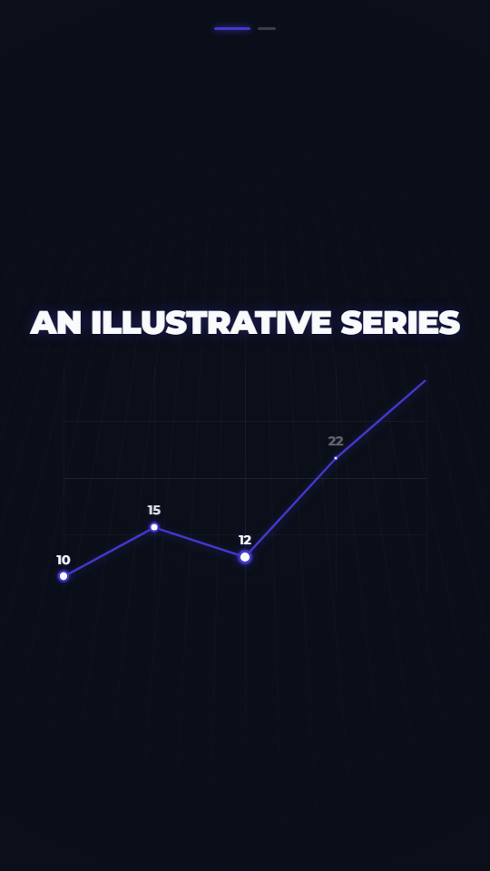

# Finance Video Engine

[](https://github.com/satwiksharma01/motion-graphic-video-generator/actions/workflows/ci.yml)

Render structured scripts as vertical motion-graphics videos with React and Remotion. Scenes include line and bar charts, comparisons, formulas, steps, graphic lists, titles, and closing cards. The composition uses a 1080 × 1920 canvas at 30 fps.



**Status: experimental.** Scene rendering is implemented. Sentiment and icon selection use keyword rules; they are not a language model or a financial-data service. Narration and background music are not generated or included.

## Quick start

Use Node.js 22 and npm. Install the locked dependencies:

```bash
git clone https://github.com/satwiksharma01/motion-graphic-video-generator.git
cd motion-graphic-video-generator
npm ci
npm run dev
```

This opens Remotion Studio. The first render may download Remotion's browser and retrieve fonts, so internet access is needed.

## Render the example

The included [example script](scripts/example.json) uses illustrative values, a line chart, and a graphic list. Export it as an MP4:

```bash
npx remotion render src/index.ts FinanceVideo out/example.mp4 --props=scripts/example.json
```

It has no audio or captions. For a quick still frame:

```bash
npx remotion still src/index.ts FinanceVideo out/example.png --props=scripts/example.json --frame=60
```

Output files go in `out/`, which is ignored by Git.

## Write a script

Each script contains a `scenes` array. Every scene needs a supported `type` and `durationInFrames`; remaining fields depend on the scene. The [TypeScript scene definitions](src/types/schema.ts) describe the shapes.

| Scene | Main fields |
|---|---|
| `hook` | `title` |
| `linechart` | `dataPoints` (numbers), optional `title` |
| `barchart` | `dataPoints` (`label`/`value` pairs), optional `title` |
| `graphiclist` | `items` (`label` and optional `icon`), optional `title` |
| `steps` | `items` (strings), optional `title` |
| `calculation` | `amount`, `result` |
| `comparison` | `itemA`, `itemB`, optional `title` |
| `formula` | `equation`, optional `variables` and `title` |
| `cta` | Optional `subtitle`, `buttonText` |

Optional scene fields include `spokenText`, `sentiment`, `intent`, and glossary/lower-third text. `spokenText` supplies text for captions; it does not synthesize speech. Set `captions: []` in direct render props to omit captions rather than loading the Studio's default subtitle file.

## Batch rendering and captions

```bash
npm run render
```

The batch command renders every JSON script in `scripts/`. It derives captions from scene text using a fixed **350 ms per word** across the combined text. These timestamps are placeholders: they are not aligned to narration or individual scene boundaries. Review them before using a video with speech. The example script has no captions when rendered directly; the batch command creates estimated captions for it, like the other scripts.

`VideoAudio.tsx` is currently a silent placeholder. Add audio assets you have permission to use and implement the audio layer before expecting a soundtrack.

## Checks

```bash
npm run lint      # ESLint and TypeScript
npm run build     # Bundle the composition
```

CI installs from the lockfile, runs both checks, and renders a real example frame. This checks that the project can compile and render; it does not measure full-video quality or caption accuracy.

## Layout

- `src/scenes/`: scene components.
- `src/FinanceVideo.tsx`: composition and transitions.
- `src/Root.tsx`: frame rate, canvas, and duration calculation.
- `src/lib/analyzer.ts`: keyword rules for sentiment and icons.
- `scripts/`: script examples and the batch renderer.

## License

[MIT](LICENSE) for the project code. Remotion and other dependencies have their own license terms; the project license does not replace those terms.
